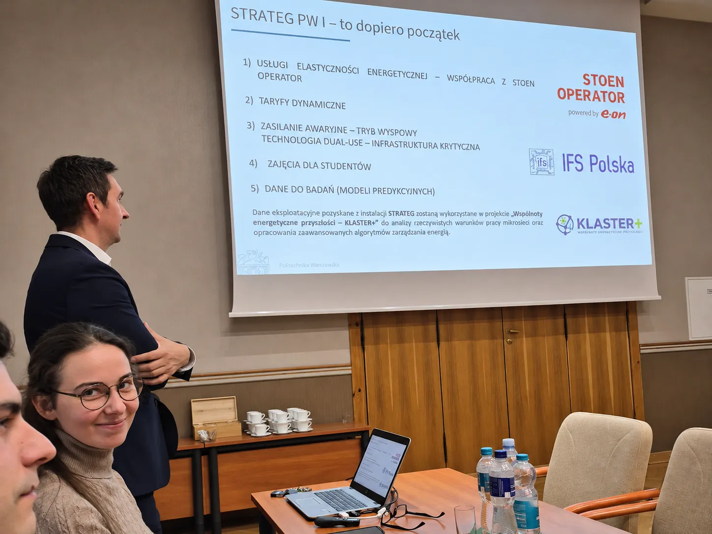

3 listopada 2026 r. w Sali Senatu Politechniki Warszawskiej odbyło się posiedzenie Komitetu Sterującego programu „Inicjatywa Doskonałości – Uczelnia Badawcza” (IDUB), poświęcone realizacji projektów **STRATEG PW I i II**.

> **Powiązane materiały** 
>
> 👉 <i class="fa-solid fa-newspaper"></i> Wizyta zespołu KLASTER+ na Wydziale Inżynierii Materiałowej PW: [**zobacz wpis**](/posts/wim-pw/).
>
> 👉 <i class="fa-solid fa-newspaper"></i> Artykuł na temat mikrosieci WIM PW (G. Komorowska, K. Kalinowski): [**pobierz PDF**]({{ '/assets/posts/2026-11-03-strateg-pw-wim-klaster-plus/pe-instalacja-fotowoltaiczna-magazyn-energi.pdf' | relative_url }}).
{: .prompt-tip }

### Uczestnicy spotkania

W spotkaniu uczestniczyli **Rektor Politechniki Warszawskiej prof. dr hab. inż. Krzysztof Zaremba** oraz prorektorzy: **prof. dr hab. inż. Mirosław Karpierz, prof. dr hab. inż. Mariusz Malinowski, prof. dr hab. inż. arch. Jan Słyk, prof. dr hab. inż. Adam Woźniak i prof. dr hab. inż. Robert Zalewski**.

Wśród pozostałych uczestników byli **prof. dr hab. inż. Tomasz Wejrzanowski, dr hab. inż. Aldona Zalewska, prof. arch. dr hab. inż. Radosław Achramowicz, mgr inż. Gabriela Komorowska, mgr inż. Krzysztof Kalinowski, dr inż. Tadeusz Daszczyński** oraz przedstawiciel **Stoen Operator**.

### Prezentacja projektu WIM PW

Podczas spotkania prof. dr hab. inż. **Tomasz Wejrzanowski**, prodziekan ds. ogólnych i nauki Wydziału Inżynierii Materiałowej PW (WIM), przedstawił rezultaty projektu **„Pilotażowa instalacja wytwarzania i magazynowania energii oparta o efektywne i trwałe technologie fotowoltaiczne i bateryjne”**.

Celem projektu realizowanego na WIM PW było ograniczenie zużycia energii elektrycznej pobieranej z sieci OSD przez budynki Politechniki Warszawskiej dzięki wykorzystaniu odnawialnych źródeł energii oraz technologii magazynowania energii. W ramach projektu przeprowadzono prace inwestycyjne i badawcze związane z pilotażową instalacją na WIM PW.

*Prezentacja rezultatów projektu STRATEG PW podczas posiedzenia Komitetu Sterującego IDUB, 3 listopada 2026 r. Od lewej: mgr inż. **Krzysztof Kalinowski**, mgr inż. **Gabriela Komorowska**, prof. dr hab. inż. **Tomasz Wejrzanowski***

W realizacji części inwestycyjnej projektu uczestniczył również dr inż. **Tadeusz Daszczyński**, kierownik projektu **KLASTER+**, pełniąc funkcję **inspektora nadzoru inwestorskiego w branży elektrycznej**. Dr inż. **Tadeusz Daszczyński** łączy działalność naukowo-dydaktyczną na Wydziale Elektrycznym PW z praktyką inżynierską, posiadając uprawnienia budowlane bez ograniczeń do projektowania i kierowania robotami budowlanymi w specjalności elektrycznej (LOD/2597/PWOE/15).

Projekt zaprezentowali prof. dr hab. inż. **Tomasz Wejrzanowski**, mgr inż. **Gabriela Komorowska** oraz mgr inż. **Krzysztof Kalinowski** (zob. zdjęcie powyżej).

W prezentacji wskazano możliwości wykorzystania instalacji STRATEG PW, w tym świadczenia usług elastyczności energetycznej we współpracy ze Stoen Operator, stosowania taryf dynamicznych, zapewnienia zasilania awaryjnego w trybie wyspowym oraz wykorzystania danych eksploatacyjnych do opracowania modeli predykcyjnych.

W prezentacji wskazano także bezpośrednie wykorzystanie rezultatów projektu STRATEG PW w pracach **KLASTER+**:

> Dane eksploatacyjne pozyskane z instalacji STRATEG zostaną wykorzystane w projekcie „Wspólnoty energetyczne przyszłości – KLASTER+” do analizy rzeczywistych warunków pracy mikrosieci oraz opracowania zaawansowanych algorytmów zarządzania energią.

Mikrosieć WIM PW została opisana w artykule **Krzysztofa Kalinowskiego** i **Gabrieli Komorowskiej**: [artykuł w „Przeglądzie Elektrotechnicznym”]({{ '/assets/posts/2026-11-03-strateg-pw-wim-klaster-plus/pe-instalacja-fotowoltaiczna-magazyn-energi.pdf' | relative_url }}).

### Wykorzystanie danych z instalacji STRATEG w projekcie KLASTER+

Planowane jest wykorzystanie danych dotyczących **produkcji i zużycia energii elektrycznej**, a także pomiarów **mocy, napięć i prądów**. Posłużą one do opracowania modeli symulacyjnych w środowisku **DIgSILENT PowerFactory** i analizy rzeczywistych warunków pracy mikrosieci. Kolejnym kierunkiem badań będzie **wykorzystanie sterowników polowych jako komputerów brzegowych** realizujących funkcje monitorowania i zarządzania energią.

W lipcu 2026 r. członkowie zespołu KLASTER+ [odwiedzili Wydział Inżynierii Materiałowej PW](/posts/wim-pw/), zapoznając się z instalacją fotowoltaiczną, magazynem energii oraz możliwościami wykorzystania infrastruktury i danych pomiarowych w dalszych badaniach. Podczas prezentacji STRATEG PW przedstawiono konkretne możliwości wykorzystania tej infrastruktury w dalszych pracach badawczych.

> <i class="fa-solid fa-envelope"></i> Newsletter: [**zapisz się tutaj**](https://klaster-plus.edu.pl/newsletter/) – wysyłamy tylko informacje o nowych wpisach.
{: .prompt-info }
